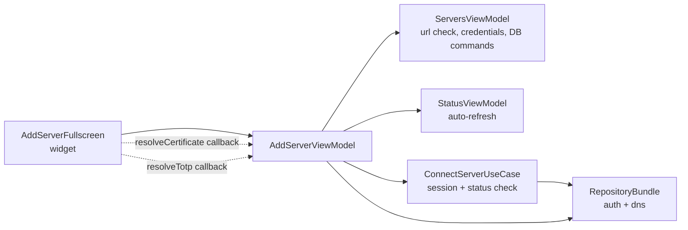
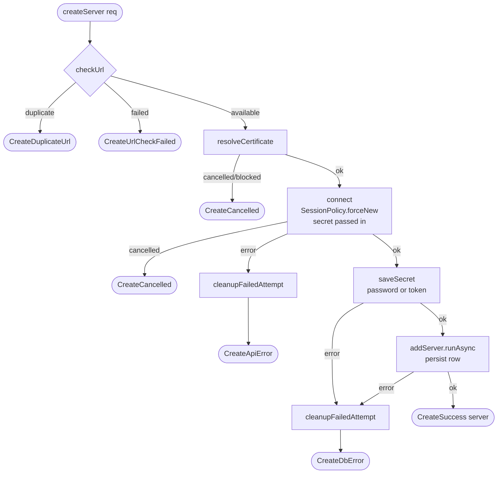
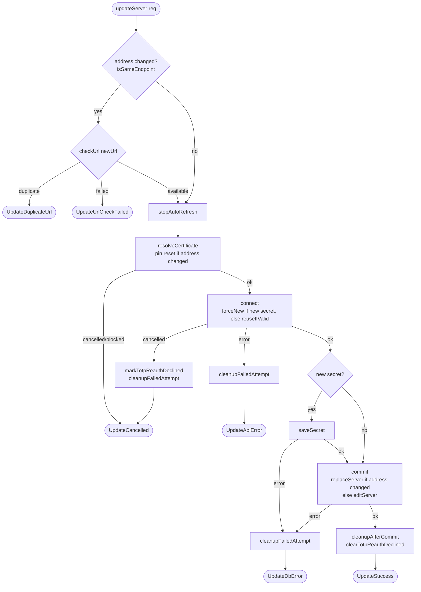
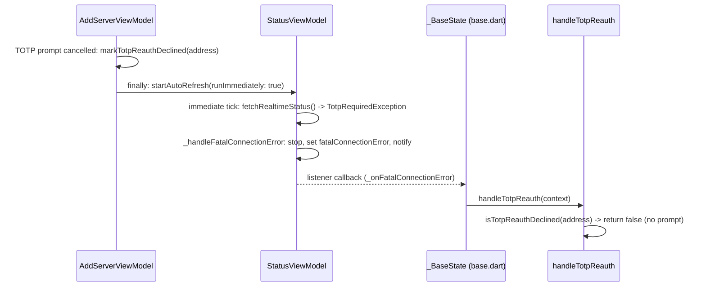
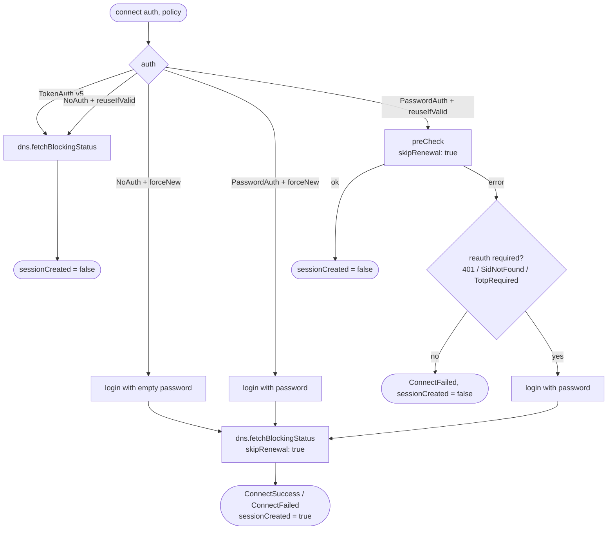
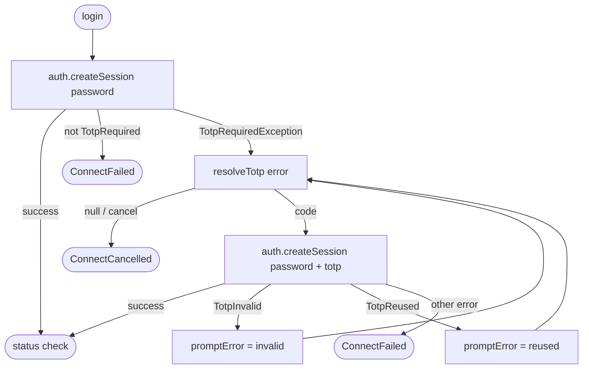
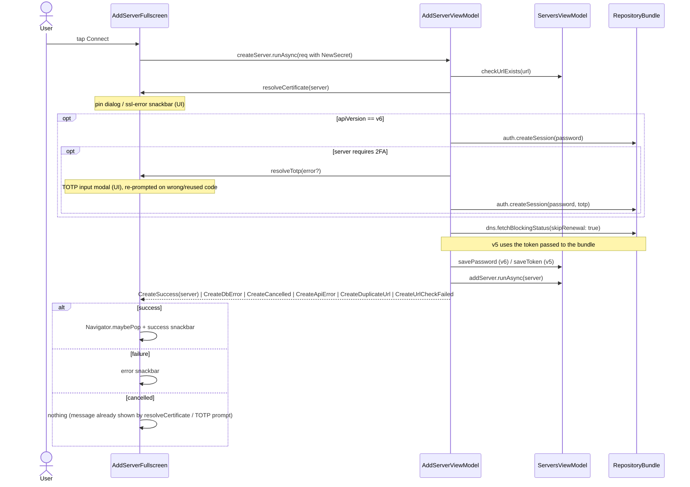
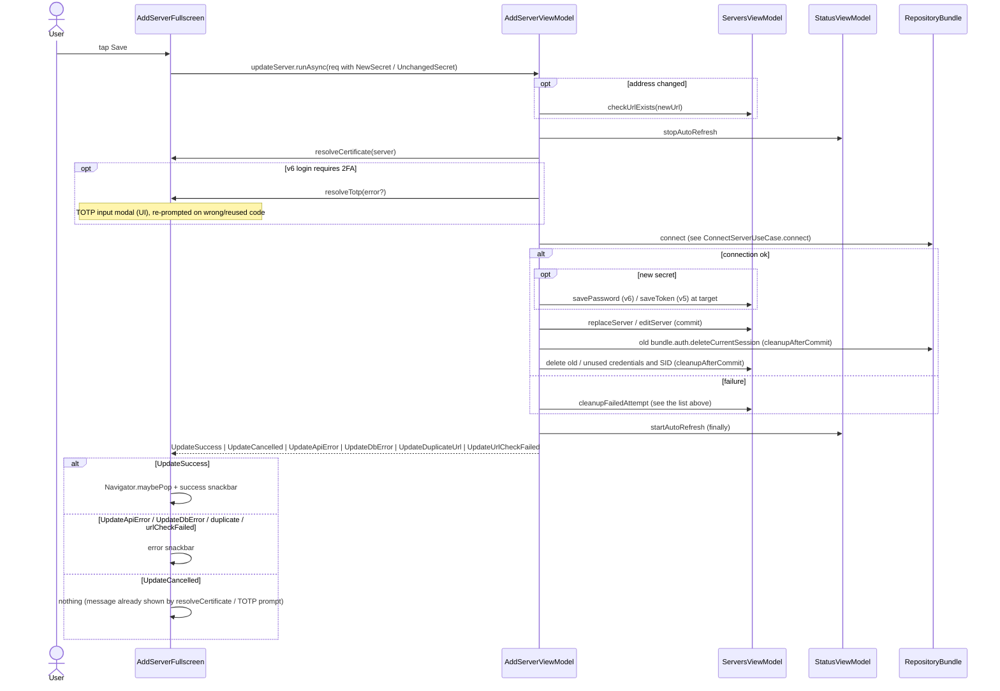

# Server Connection Flow (add / edit)

How the **Add / Edit server** screen connects to a Pi-hole and persists it.

- UI: `lib/ui/servers/widgets/add_server_fullscreen.dart` (`AddServerFullscreen`)
- Orchestration: `lib/ui/servers/view_models/add_server_viewmodel.dart`
  (`AddServerViewModel.createServer` / `updateServer`)
- Session setup and status check:
  `lib/domain/use_cases/server_connection/connect_server_usecase.dart`
  (`ConnectServerUseCase`)

The view model owns the orchestration and returns a sealed outcome
(`CreateOutcome` / `UpdateOutcome`). The widget builds the request, awaits the
command and maps the outcome to UI (snackbar / navigation). UI that the
orchestration needs mid-flow is injected per request as callbacks, so the view
model never touches `BuildContext`:

- `resolveCertificate` - the certificate pin dialog + SSL-error snackbar.
- `resolveTotp` - the 6-digit TOTP (2FA) input modal, used on v6 login when the
  server requires two-factor auth. Returns the entered code or `null` on cancel.

## Layers

## Credentials: checked first, stored after

The password (v6) or token (v5) is called the **secret** here. The connection
check uses the secret from the form. It is **not** stored before the check, so
a failed or cancelled check has no stored secret to undo.

- **v6**: the password goes to `auth.createSession` as an argument.
- **v5**: the token goes to the bundle (`CreateRepositoryBundle(server:,
  token:)`). The v5 repositories use it instead of the stored token, also after
  a retry.

After the check passes, only the key for the selected version is stored
(`savePassword` for v6, `saveToken` for v5). A failed write stops the flow with
`CreateDbError` / `UpdateDbError`.

The widget sends the secret as a `SecretInput`
(`lib/domain/model/server/secret_input.dart`):

- `NewSecret` - always on add. On edit, when the value or the version changed.
- `UnchangedSecret` - on edit, when the version and the value are the same as
  the loaded ones.

On edit, the secret is treated as new when it is a `NewSecret`, the address
changed (nothing is stored under the new address yet), **or** the version
changed (the key of the new version is not stored yet). A new secret is
checked with a new session (`SessionPolicy.forceNew`) and stored after the
check. An unchanged secret keeps the current session while it works
(`SessionPolicy.reuseIfValid`) and is not written again.

## Add a new server - `createServer`

A cancelled/blocked certificate **aborts** the add (`CreateCancelled`) before
any connection. A cancelled TOTP prompt also returns `CreateCancelled`; nothing
was stored, so there is nothing to undo.

`createServer` persists the server row before returning `CreateSuccess`, so the
widget only pops and shows the success snackbar.

## Edit an existing server - `updateServer`

A cancelled/blocked certificate **aborts** the save (`UpdateCancelled`); the
message was already shown by `resolveCertificate`. When a server is selected,
auto-refresh is stopped for the duration and started again in a `finally`, so
every exit path restarts it.

`startAutoRefresh` runs after every outcome above (from the `finally`). On
`UpdateSuccess` the widget pops and shows the success snackbar.

### Cleanup after a failure - `_cleanupFailedAttempt`

One cleanup is used for every failure after the certificate step, in both
`createServer` and `updateServer`.

- **Log out the new session** on the server - when this attempt created a
  session.
- **Delete the SID** under the target address - when the address is new, or
  this attempt created a session.
- **Delete the password and the token** under the target address - when the
  address is new and the secret was already stored.

With the **same address**, a stored secret is never restored or removed:

- it was not changed (`UnchangedSecret`), or
- it passed the connection check, so it works.

This also holds when the DB write fails after the secret was stored: the
outcome is `UpdateDbError`, the DB row keeps the old settings, and the stored
secret is the new, checked one. Saving again on the same screen stores
everything.

The SID is deleted when a session was created, because that session was just
logged out. The old session it replaced is left to time out on the server.

### Cleanup after a successful commit - `cleanupAfterCommit`

Runs only after the commit, so a failed save never logs out a working session.

- **Old server was v6, and the address changed or the new version is v5**:
  log out the old session (best effort).
- **Address changed**: delete the token, password, SID and 2FA-declined mark
  of the old address.
- **Same address, v6 -> v5**: delete the password and the SID (no longer
  used).
- **Same address, v5 -> v6**: delete the token (no longer used).

### Auto-refresh after a cancelled TOTP prompt

`startAutoRefresh()` runs its first tick **immediately**
(`runImmediately: true`). If the edit's TOTP prompt was cancelled and the
session is invalid on the server, that tick hits `TotpRequiredException`. The
shell-level error handler then calls `handleTotpReauth`.

The edit marks the target address as reauth-declined when its prompt is
cancelled (`markTotpReauthDeclined`). `handleTotpReauth` checks this mark and
returns early, so no second prompt appears. A refresh that the user starts
still prompts again (`totp_fake_test.dart`). A successful edit clears the mark
(`clearTotpReauthDeclined`).

See `lib/ui/shell/base.dart` (`_onFatalConnectionError`) and
`lib/ui/core/actions/handle_totp_reauth.dart`.

## Session setup - `ConnectServerUseCase.connect`

Shared by the add / edit flow and the connect flow. It sets up the v6 session
and then checks the blocking status. The `ServerAuth` comes from the server
version and the secret: v5 -> `TokenAuth`, v6 with an empty password ->
`NoAuth`, otherwise `PasswordAuth`.

It logs in again only when needed, so a transient failure (503/504/timeout)
does not create a duplicate session.

The outcome is `ConnectSuccess`, `ConnectFailed` or `ConnectCancelled`. Both
`ConnectSuccess` and `ConnectFailed` say whether a session was created, so the
caller knows what to clean up.

### TOTP login - `_login`

The first attempt sends the password only; a 2FA server answers with
`TotpRequiredException`, then the loop collects a code via `resolveTotp` and
retries with `password + totp`. A wrong or reused code re-prompts (with a
localized reason); a `null` code (user dismissed) returns `ConnectCancelled`.
Rate-limit or any other error is terminal (`ConnectFailed`).

A successful `createSession` stores the new SID.

## Sequence - add a new server

## Sequence - edit an existing server

## Outcome → UI mapping

| Outcome                                         | Widget reaction                                                      |
| ----------------------------------------------- | -------------------------------------------------------------------- |
| `CreateSuccess(server)`                         | pop → "connected successfully" (the row is already saved)            |
| `UpdateSuccess`                                 | pop → "edited successfully"                                          |
| `CreateDuplicateUrl` / `UpdateDuplicateUrl`     | "connection already exists" snackbar                                 |
| `CreateUrlCheckFailed` / `UpdateUrlCheckFailed` | "cannot check URL" snackbar                                          |
| `CreateApiError` / `UpdateApiError`             | status-code-specific error snackbar + log (`handleApiErrorResult`)   |
| `CreateDbError` / `UpdateDbError`               | "cannot save connection data" snackbar                               |
| `CreateCancelled` / `UpdateCancelled`           | nothing - certificate dialog / SSL error / TOTP prompt already shown |

## Notes

- **Create and edit behave symmetrically on certificate cancel**: both
  `createServer` and `updateServer` abort (`CreateCancelled` / `UpdateCancelled`)
  when the pin dialog is cancelled or the certificate is blocked; no connection
  is attempted.
- The view model never shows UI itself. The certificate pin dialog and SSL-error
  snackbar live in the widget and are reached via the `resolveCertificate`
  callback passed in the request. Every path that blocks on a certificate must
  show its own message there, including the one where the fingerprint cannot be
  fetched at all (e.g. HTTPS picked for a plain HTTP port) - otherwise the
  `Cancelled` outcome maps to a silent no-op and the user sees nothing.
- **TOTP (2FA) is v6-only and handled inside login** (`ConnectServerUseCase`).
  The view model never shows the prompt; it passes the injected `resolveTotp`
  callback, which the widget backs with the TOTP input modal. Wrong / reused
  codes re-prompt with a localized reason; a dismissed prompt cancels the whole
  flow (`CreateCancelled` / `UpdateCancelled`).
- **Known limitation**: logging out the new session during cleanup
  (`auth.deleteCurrentSession`) renews the session on a 401. The renewal reads
  the **stored** password, not the one being checked. This only happens when
  the DELETE fails with 401 right after a successful login. See the comment in
  `lib/data/repositories/api/v6/auth_repository.dart`.
- The connecting overlay is driven by a local `isConnecting` flag toggled around
  `runAsync`.
- See also: [ARCHITECTURE.md](ARCHITECTURE.md).
