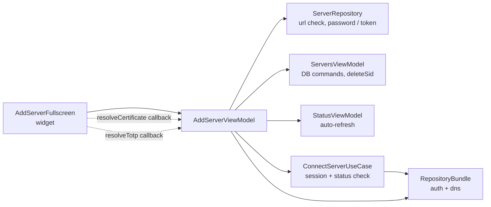
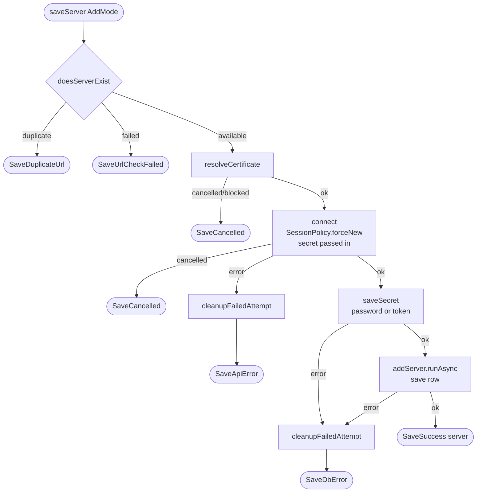
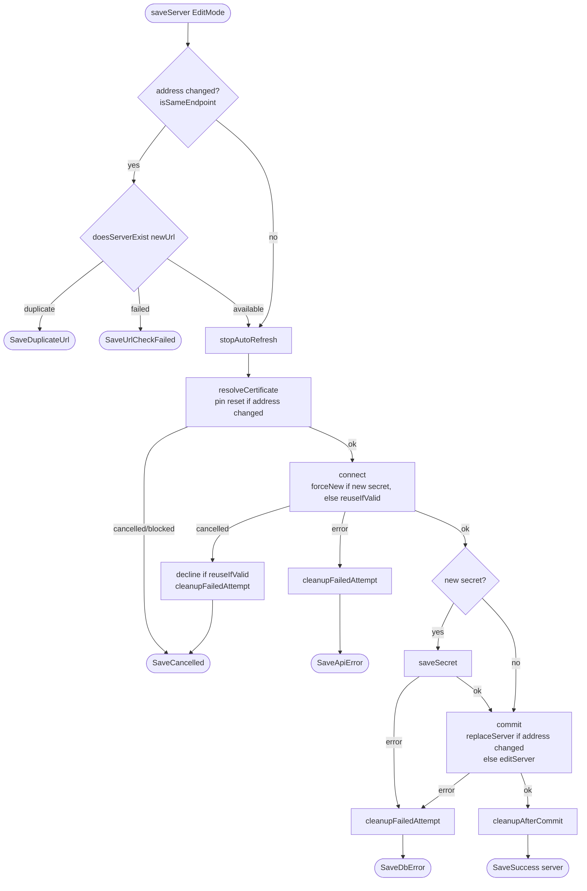
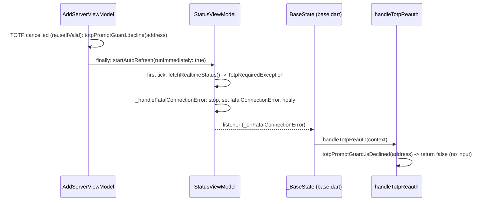
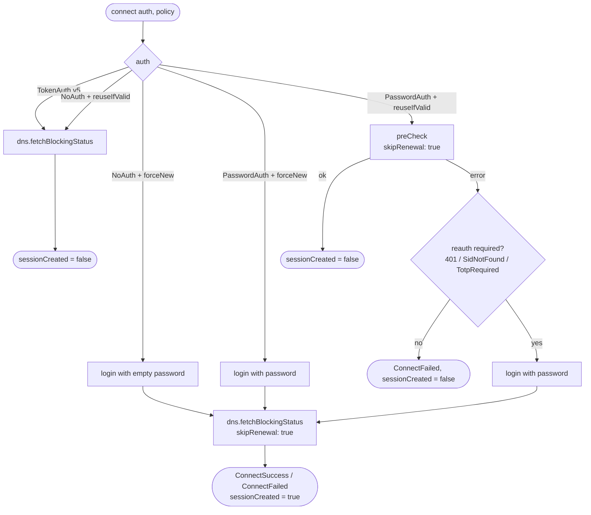
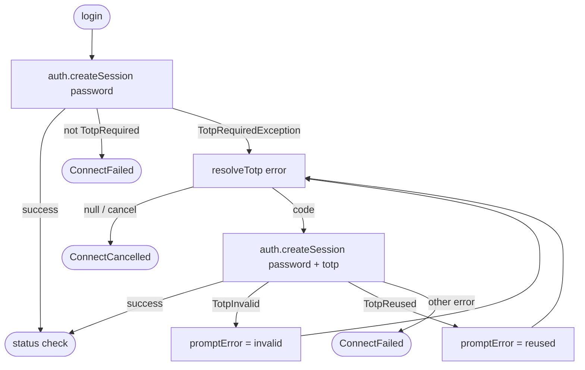
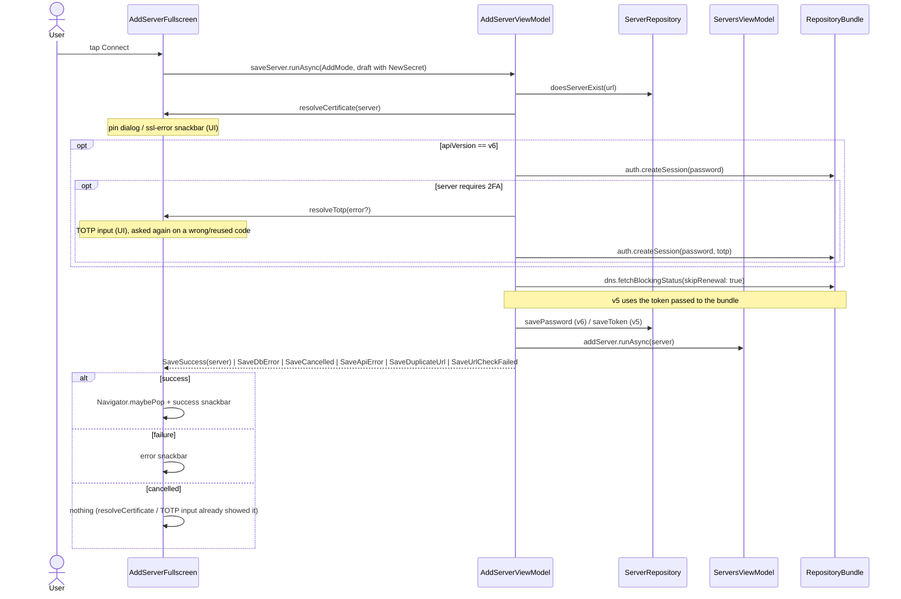
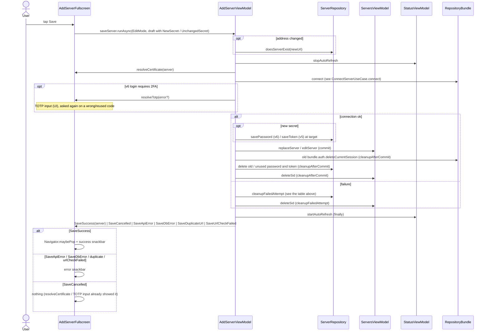

# Server Connection Flow (Add / Edit)

This document shows how the Add / Edit Server screen tests and saves a Pi-hole
connection.

- UI: `lib/ui/servers/widgets/add_server_fullscreen.dart`
- Flow: `lib/ui/servers/view_models/add_server_viewmodel.dart`
- Connection check:
  `lib/domain/use_cases/server_connection/connect_server_usecase.dart`

`AddServerViewModel.saveServer` runs the flow and returns a
`SaveServerOutcome`. The widget then shows a message or closes the screen.

The view model does not use `BuildContext`. The widget provides callbacks for
the certificate check (`resolveCertificate`) and TOTP input (`resolveTotp`).

## Layers

## Secret handling

The secret is a v6 password or a v5 token. It is tested first and saved only
after the connection succeeds.

The widget sends:

- `NewSecret`: add mode, or a changed secret/version
- `UnchangedSecret`: the secret and version did not change

A changed address also makes the secret new because the new address has no
stored secret.

| Secret | Session policy | Save again |
| --- | --- | --- |
| New | `forceNew` | Yes |
| Unchanged | `reuseIfValid` | No |

Only the secret for the selected version is saved. A write failure returns
`SaveDbError`.

## Add server

A blocked or cancelled certificate check stops the flow before connection.
Cancelling TOTP also stops it. Nothing has been saved yet.

The row is saved before `SaveSuccess`. The widget then closes the screen and
shows a success message.

## Edit server

A blocked or cancelled certificate check returns `SaveCancelled`.
Auto-refresh stops during the save and always restarts in a `finally` block.

### Cleanup after failure

`_cleanupFailedAttempt` is used after failures following the certificate
check.

| Action | When |
| --- | --- |
| Log out the new session | A session was created |
| Delete the SID | The address is new, or a session was created |
| Delete password and token | The address is new and the secret was saved |

All actions use the target address. Credentials for the current address are
not deleted.

If the database write fails after saving a tested secret, the old server row
remains and the tested secret stays stored. The user can save again.

### Cleanup after success

`cleanupAfterCommit` runs only after the database update succeeds:

- Old v6 session: log out when the address changes or the new version is v5
- Old address: delete its token, password, and SID
- Same address, v6 to v5: delete the password and SID
- Same address, v5 to v6: delete the token

### Cancelled TOTP and auto-refresh

Auto-refresh runs immediately after an edit. It could reopen the TOTP input
just after the user cancelled it.

`TotpPromptGuard` prevents this:

- Cancel with `reuseIfValid`: mark the prompt as declined
- Automatic refresh: do not show the marked prompt
- Manual refresh: clear the mark and allow the prompt
- Successful login or server deletion: remove the mark

The mark is not added with `forceNew`, because the old SID may still work.

See `lib/ui/shell/base.dart`,
`lib/ui/core/actions/handle_totp_reauth.dart`, and `totp_fake_test.dart`.

## Certificate check

`CertificateCheckUseCase` contains the rules and does not show UI. The caller
shows the pin dialog and blocked-certificate message.

| Method | Use |
| --- | --- |
| `checkBeforeSave` | Check before add/edit |
| `needsPinBeforeConnect` | Decide whether a pin is needed |
| `repin` | Save a new pin |
| `hasConfirmedPinMismatch` | Choose Update or Edit after a 495 error |

Saving is stricter than connecting. It can pin a trusted certificate and block
an untrusted certificate in strict mode. A connection failure returns 495 and
starts recovery.

Tests are in
`test/domain/use_cases/server_connection/certificate_check_usecase_test.dart`.

## Session setup

`ConnectServerUseCase.connect` sets up the session and checks the blocking
status.

- v5: `TokenAuth`
- v6 with an empty password: `NoAuth`
- v6 with a password: `PasswordAuth`

With `reuseIfValid`, login happens only after an authentication error. Short
failures such as 503, 504, or a timeout do not create another session.

The result is `ConnectSuccess`, `ConnectFailed`, or `ConnectCancelled`.
It also reports whether a new session was created for cleanup.

### TOTP login

The first login uses the password only. If TOTP is required, `resolveTotp`
asks for a code and login runs again.

| Result | Next step |
| --- | --- |
| Success | Check status |
| Invalid or reused code | Ask again |
| Cancel | Return `ConnectCancelled` |
| Rate limit or other error | Return `ConnectFailed` |

A successful `createSession` stores the new SID.

## Add sequence

## Edit sequence

## Outcomes

| Outcome | UI action |
| --- | --- |
| `SaveSuccess` | Close the screen and show success |
| `SaveDuplicateUrl` | Show "connection already exists" |
| `SaveUrlCheckFailed` | Show "cannot check URL" |
| `SaveApiError` | Show the API error |
| `SaveDbError` | Show "cannot save connection data" |
| `SaveCancelled` | Do nothing; the dialog already handled it |

## Notes

- TOTP is available only in v6.
- A local `isConnecting` flag controls the loading overlay.
- Known limit: if `auth.deleteCurrentSession` returns 401, session renewal
  uses the stored password, not the password being tested. See
  `lib/data/repositories/api/v6/auth_repository.dart`.
- See also [ARCHITECTURE.md](ARCHITECTURE.md).
